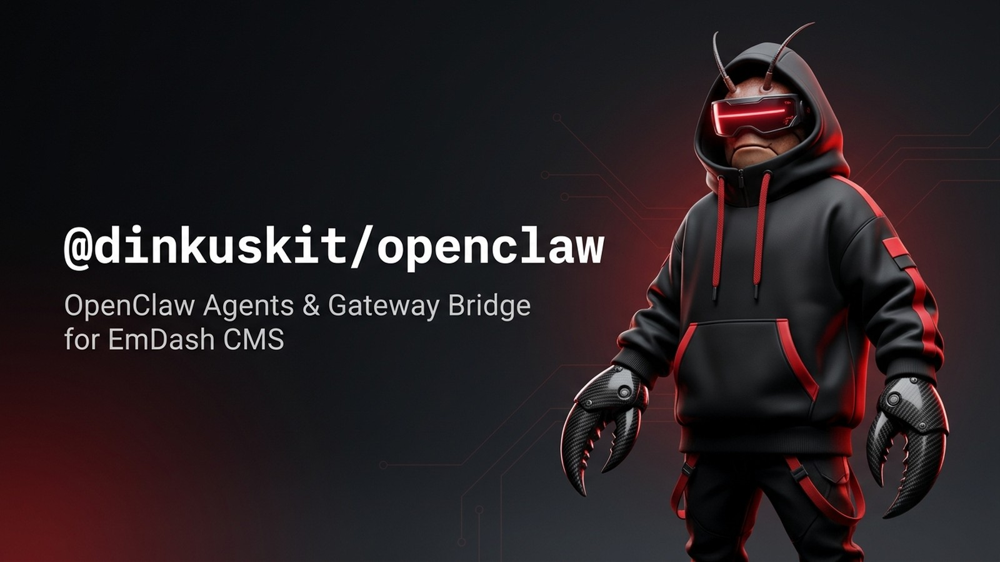

# @dinkuskit/openclaw

<p align="center">
  
</p>

<p align="center">
  <a href="https://github.com/dinkuskit/openclaw/actions/workflows/ci.yml"></a>
  <a href="https://www.npmjs.com/package/@dinkuskit/openclaw"></a>
  <a href="https://github.com/openclaw/openclaw"></a>
  <a href="https://github.com/emdash-cms/emdash"></a>
  <a href="LICENSE"></a>
</p>

<p align="center">
  <a href="#installation-profiles">Profiles</a> &middot;
  <a href="#architecture--system-flow">Architecture</a> &middot;
  <a href="#security--authority-model">Security &amp; Authority</a> &middot;
  <a href="docs/design/dinkusclaw-character-and-pet-rig.md">DinkusClaw Spec</a> &middot;
  <a href="#verification">Verification</a>
</p>

`* * *`

Connect custom [OpenClaw](https://github.com/openclaw) agents and gateways to [EmDash CMS](https://github.com/emdash-cms/emdash) and [DinkusKit](https://github.com/dinkuskit) stores (`dinkus-openclaw`).

> **Gateway owns conversation execution. EmDash owns CMS mutations. The bridge connects them; the UI projects their state.**

---

## Architecture & System Flow

```
 ┌────────────────────────────────────────────────────────┐
 │            External OpenClaw Gateway Host              │
 │  - Protocol v4 WebSocket (@openclaw/gateway-client)    │
 │  - Autonomous Execution & Agent Workspaces             │
 └───────────────────────────┬────────────────────────────┘
                             │ loopback ws:// or TLS wss://
                             ▼
 ┌────────────────────────────────────────────────────────┐
 │           @dinkuskit/openclaw Server Bridge            │
 │  - Server-side Ed25519 device authentication           │
 │  - Astro authenticated SSE stream endpoint             │
 │  - Dual-authority draft & execution gatekeeper         │
 └─────────────┬────────────────────────────┬─────────────┘
               │ Native Profile             │ Sandbox Profile
               ▼                            ▼
 ┌───────────────────────────┐ ┌──────────────────────────┐
 │    In-Process React Admin │ │  Sandboxed Registry      │
 │  <openclaw-emdash-chat>   │ │  Declarative Block Kit   │
 │  Live delta streaming     │ │  < 128 KiB backend.js    │
 └───────────────────────────┘ └──────────────────────────┘
```

---

## Installation Profiles

`@dinkuskit/openclaw` ships two mutually exclusive installation profiles sharing the `dinkus-openclaw` product identity so both mount cleanly at `/_emdash/admin/plugins/dinkus-openclaw/openclaw` and in saved-entry Content Editor panels:

### 1. Native Interactive Harness (`@dinkuskit/openclaw/native` + `@dinkuskit/openclaw/astro`)

Trusted in-process EmDash React Admin + SolidJS Web Component harness (`<openclaw-emdash-chat>`) with an Antigravity 2.0 &times; OpenClaw Control-UI workspace, live host-side SSE streaming, and a persistent Node `@openclaw/gateway-client@2026.11.1` Protocol v4 WebSocket bridge.

```ts
// astro.config.mjs
import { defineConfig } from "astro/config";
import emdash from "emdash/astro";
import { openclawNativePlugin } from "@dinkuskit/openclaw/native";
import { openclawBridge } from "@dinkuskit/openclaw/astro";

export default defineConfig({
  integrations: [
    openclawBridge(), // Mounts authenticated SSE route at /_emdash/api/openclaw/stream
    emdash({
      plugins: [openclawNativePlugin()],
    }),
  ],
});
```

- **Exports:**
  - `@dinkuskit/openclaw/native` &mdash; `openclawNativePlugin()` descriptor + `createPlugin()` runtime (`schema:read`, `content:read`, `content:revisions:read`, `network:request:unrestricted`; never `content:write`).
  - `@dinkuskit/openclaw/admin` &mdash; Thin React host adapters (`pages["/openclaw"]` and `contentEditorPanels`) mounting one precompiled SolidJS Shadow-DOM island (`<openclaw-emdash-chat>`).
  - `@dinkuskit/openclaw/astro` &amp; `@dinkuskit/openclaw/stream-endpoint` &mdash; Authenticated Astro host SSE bridge outside EmDash's buffered plugin route dispatcher (`locals.user.role >= 40` + per-user personal/shared audience filtering).

### 2. Sandboxed Registry Profile (`@dinkuskit/openclaw` + `@dinkuskit/openclaw/sandbox`)

Capability-gated sandboxed Registry plugin (`backend.js` ~52 KiB, well under EmDash's 128 KiB Registry limit) rendering an honest declarative Block Kit fallback (`@emdash-cms/blocks/server`) with pairing, authority controls, and approval queues when the native Astro/React integration is not installed.

---

## Security & Authority Model

1. **Server-Owned OpenClaw Gateway Protocol v4 Bridge (`src/gateway-bridge.ts`):**
   - Uses `@openclaw/gateway-client@2026.11.1` (`PROTOCOL_VERSION` v4) over loopback `ws://127.0.0.1` / `ws://localhost` or TLS `wss://` (rejecting non-loopback cleartext `ws://`).
   - Generates and persists an Ed25519 device identity (`ed25519:...`), bootstrap/gateway token, and issued `deviceToken` inside EmDash's encrypted `ctx.settings("connection")` secret store&mdash;never exposed to browser JS.
   - Supports `#token=` Control UI fragment paste extraction, `sessions.messages.subscribe` live delta &amp; tool streaming, mid-run `chat.send` (`queueMode: "steer"`), and `chat.abort` (session-scoped without `sessionId`).
2. **Dual Approval Authority (`src/chat-engine.ts`, `src/ui/openclaw-chat-element.tsx`):**
   - **EmDash CMS Draft Proposals (`CMS Draft &middot; rev #N`):** Editors (`role >= 40`) review field diffs against draft-safe fields (excluding SEO and live publication status metadata) and save drafts through same-origin `GET/PUT /_emdash/api/content/:collection/:id` guarded by EmDash `_rev` optimistic concurrency.
   - **Immutable `"Edit & Approve"` &amp; Receipt Reconciliation:** Editing a proposal (`revise_proposal`) marks the parent `superseded` and mints `revisionNumber + 1`. Browser receipts (`applied` / `outcome_unknown`) are verified server-side against stored EmDash content and staged draft revisions (`content:revisions:read`) to prevent duplicate writes.
   - **OpenClaw Gateway Execution Approvals (`Gateway Approval &middot; exec | plugin | system-agent`):** Permission to edit CMS content **never** grants Gateway execution approval authority. Execution approvals render as read-only handoff cards (`Review in Gateway Control UI &nearr;`) unless the viewer is a **Site Administrator (`role >= 50`)**, explicit `allowGatewayExecApprovals` opt-in is enabled, and the Gateway connection holds `operator.approvals` scope.
3. **Per-User Thread Isolation & Hardened MCP Pairing (`src/admin.ts`, `src/stream-endpoint.ts`):**
   - Conversations default to `visibility: "personal"` (`ownerUserId`-scoped in both workspace snapshots and live SSE streams) with an explicit topbar `Personal` / `Shared` toggle.
   - Public `/pair` requires a CSPRNG 15-minute admin pairing code to mint a scoped `sessionToken`, and MCP `tools/call` / REST polling enforce `X-OpenClaw-Token: <sessionToken>` or JSON `sessionToken`.

---

## Mascot: DinkusClaw

`dinkuskit/openclaw`'s identity is embodied by **DinkusClaw** &mdash; a streetwear cyber-crustacean mascot sporting an oversized matte obsidian techwear hoodie with bold crimson cords, carbon-fiber claw gauntlets, and a glowing red holographic HUD visor.

See the complete [DinkusClaw Character Ecosystem &amp; Extended Spec](docs/design/dinkusclaw-character-and-pet-rig.md) for master turnarounds, 6-state expression sheets, and GitHub App avatar packs.

---

## Verification

```sh
npm install
./bin/verify-openclaw full
```

## Status

Public runnable plugin (`0.0.0`, `private: true`). MIT.
