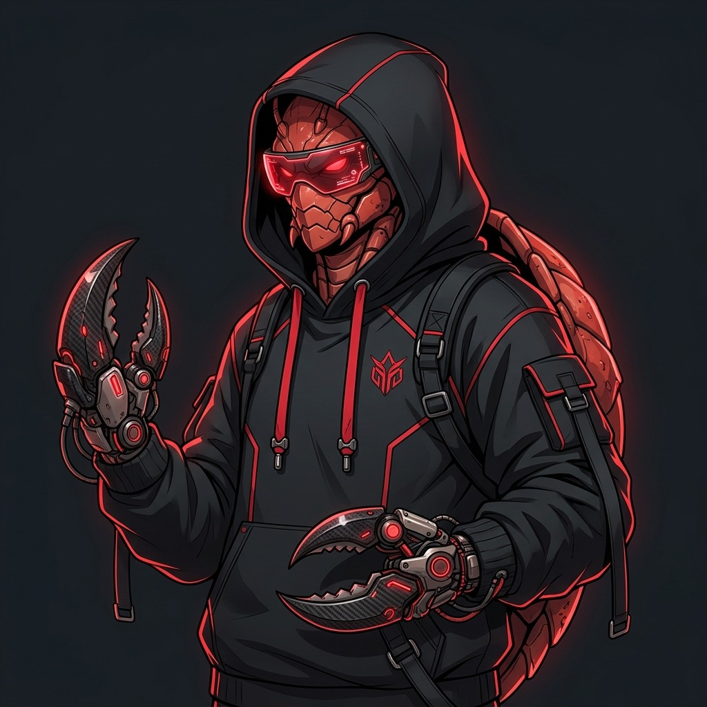
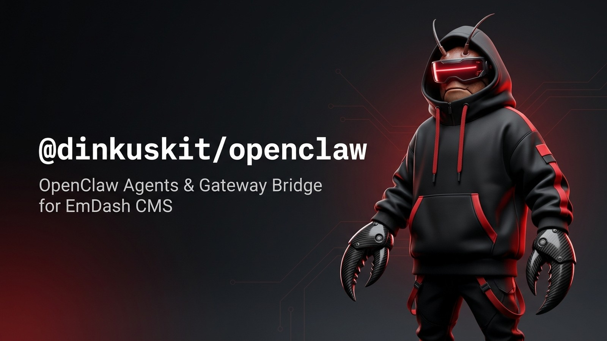
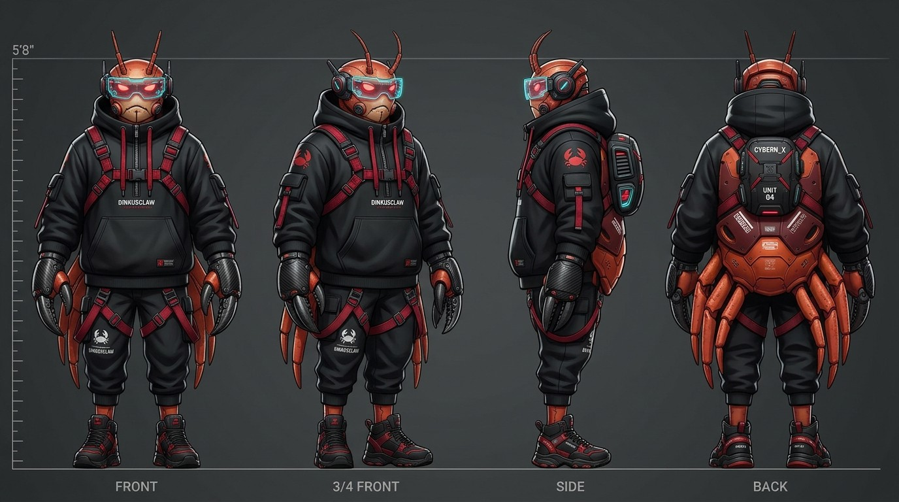
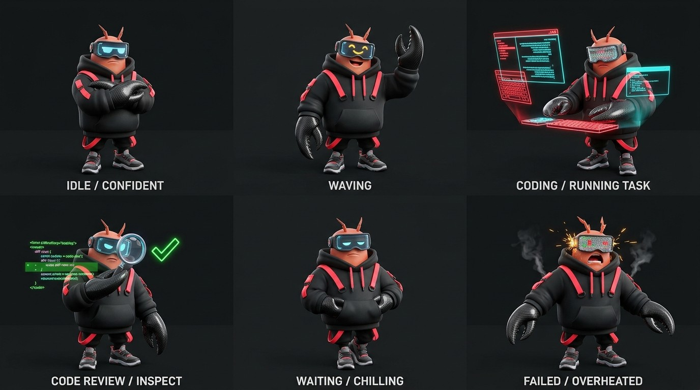

# DinkusClaw Character Ecosystem & GitHub Identity Pack

This document locks the visual specification, repository front-door artwork, and GitHub App identity pack for **DinkusClaw** (`@dinkuskit/openclaw`, plugin slug `dinkus-openclaw` — **Candidate D: Streetwear Cyber-Claw Mascot**):

1. **Master Hero Avatar (`1:1`) & GitHub App Avatar Pack**: Square studio portrait (`1024×1024`) plus circle-crop-safe `512×512` PNG badges (`< 1 MB`) for GitHub App / bot commenter profiles.
2. **Repository Social Preview (`1280×640`) & README Hero Banner (`16:9`)**: OpenGraph `2:1` card (`< 1 MB`) for `https://github.com/dinkuskit/openclaw/settings` and widescreen `1600×900` README banner (`< 500 KB`).
3. **Orthographic Turnaround & Expression Sheets**: 4-angle turnaround (`Front, 3/4, Side, Back`) and 6-state expression/action reference sheet (`Idle/Confident, Waving, Coding/Task, Review/Inspect, Waiting/Chilling, Failed/Overheated`).
4. **SVG Vector Mark**: Minimalist geometric `32×32` claw pincer mark (`< 2 KB`) for navbar, favicon, and CLI emblems.

---

## Locked Visual & Mechanical Specification

- **Character Identity (`DinkusClaw — Streetwear Cyber-Claw Mascot`, GrillTrack Round 1A Winner)**: Compact, athletic cyber-crustacean mascot (`1.6×` head-to-body chibi scale) sporting an oversized matte-obsidian techwear hoodie with bold crimson-red cords and geometric seam piping.
- **Head & Optical Array**: Shadowed hood cavity revealing twin high-intensity crimson-red holographic HUD visor sunglasses displaying live agent telemetry, with twin micro-antenna sensors emerging through the hood crest.
- **Manipulators & Carapace**:
  - **Claw Gauntlets**: High-modulus carbon-fiber forearm gauntlets terminating in sharp, tactile dual-blade pincer claws capable of high-speed terminal typing, code diff inspection, and dual-authority CMS approval gating.
  - **Locomotion**: Articulated mechanical cyber sneakers with hydraulic tread soles, planted firmly on the ground baseline.
- **Color Palette & Material Tokens**:
  - **Base Chassis**: Matte Obsidian Black (`#16161A`)
  - **Signature Accent**: Bold Crimson Red (`#FF2A2A`) on cords, piping, and HUD glow
  - **Telemetry Secondary**: Electric Cyan (`#00F0FF`) on circuit traces and lens iris
  - **Metals**: Brushed Dark Titanium & Woven Carbon-Fiber

---

## Asset Manifest & Verification

All assets verified with `verify_github_assets.py` against GitHub's `< 1 MB` file cap and exact dimension rules:

| Surface | File Path | Aspect / Dimensions | Format & Size |
| --- | --- | :---: | --- |
| **README Hero Banner** | `.github/assets/dinkusclaw-readme-banner-16x9.jpg` | `16:9` (`1600×900`) | JPEG (`158 KB`) |
| **Repo Social Preview** | `.github/assets/dinkusclaw-repo-social-preview-1280x640.png` | `2:1` (`1280×640`) | PNG (`848 KB`) |
| **GitHub App / Org Avatar** | `.github/assets/dinkusclaw-github-app-avatar-512x512.png` | `1:1` (`512×512`) | PNG (`345 KB`) |
| **PR-Comment Tight Badge** | `.github/assets/dinkusclaw-github-app-badge-tight-512x512.png` | `1:1` (`512×512`) | PNG (`374 KB`) |
| **Master Hero Avatar** | `.github/assets/dinkusclaw-master-hero-avatar.jpg` | `1:1` (`1024×1024`) | JPEG (`194 KB`) |
| **4-Angle Turnaround Sheet** | `.github/assets/dinkusclaw-turnaround-sheet.jpg` | `16:9` (`1600×900`) | JPEG (`209 KB`) |
| **6-State Expression Sheet** | `.github/assets/dinkusclaw-expression-sheet.jpg` | `16:9` (`1600×900`) | JPEG (`158 KB`) |
| **Vector Favicon / Mark** | `.github/assets/dinkusclaw-mark.svg` | `1:1` (`32×32`) | SVG (`1.0 KB`) |

---

## Visual Reference Sheets

### Master Hero Avatar & Repository Banner

| Master Hero Avatar (`1:1`) | README Hero Banner (`16:9`) |
| :---: | :---: |
|  |  |

### 4-Angle Turnaround & 6-State Expression Sheets

| 4-Angle Orthographic Turnaround Sheet | 6-State Expression & Action Reference Sheet |
| :---: | :---: |
|  |  |

---

## 6-State Expression Matrix

| State | Visor Telemetry | Pincer & Body Pose | Behavioral Role |
| --- | :---: | --- | --- |
| **01 — Idle / Confident** | Crimson line `[ - - ]` | Relaxed stance, arms crossed, pincer blades closed | Passive gateway standby |
| **02 — Waving Hello** | Cheerful arcs `[ ^ ^ ]` | One claw raised high, open pincer greeting | New connection & pairing handshake |
| **03 — Coding / Hacking** | Rapid sweep `[ > < ]` | Dual claws typing on floating red/cyan holographic keyboard | Executing agent tasks & generating drafts |
| **04 — Review / Inspect** | Reticle focus `[ O O ]` | Holding digital magnifying lens inspecting holographic diffs | Dual-authority approval evaluation |
| **05 — Waiting / Chilling** | Dim pulse `[ . . ]` | Leaning back, pincers tucked in hoodie pockets | Idling on SSE connection |
| **06 — Failed / Overheated** | Amber warning `[ ! ! ]` | Startled recoil, glitching visor, smoke curls from hoodie vent | Gateway disconnected or approval rejected |
